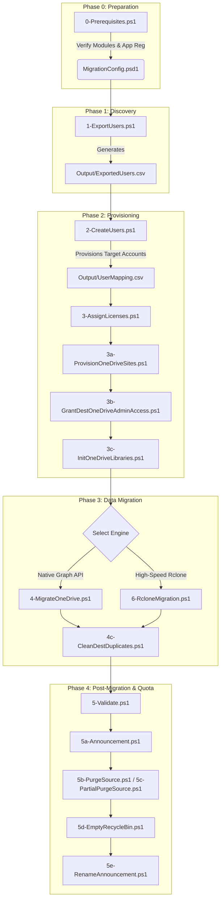

# M365Migration: Enterprise Microsoft 365 & OneDrive Migration Suite

[](LICENSE)
[](https://github.com/thanquannguyen/M365Migration/stargazers)
[](https://github.com/thanquannguyen/M365Migration/forks)
[](https://github.com/thanquannguyen/M365Migration/commits/main)
[](https://github.com/thanquannguyen/M365Migration)


A robust, enterprise-grade PowerShell toolkit for automated **cross-tenant Microsoft 365 (Office 365) user lifecycle and OneDrive data migration**. Engineered for production environments, large data volumes, and memory-constrained environments (e.g., 1 GB RAM / 2 vCPU VPS).

---

## Contents

- [Key Highlights](#key-highlights)
- [Architecture & Migration Workflow](#architecture--migration-workflow)
- [Repository Structure](#repository-structure)
- [Prerequisites](#prerequisites)
- [Configuration](#configuration)
- [Execution Guide](#execution-guide)
- [Rollback & Recovery](#rollback--recovery)
- [Limitations & Expectations](#limitations--expectations)
- [Utility Scripts](#utility-scripts)
- [Time & Limits](#time--limits)
- [Security & Operational Safeguards](#security--operational-safeguards)
- [Contributing](#contributing)
- [License](#license)

---

## Key Highlights

- **End-to-End Automation**: Covers the entire migration lifecycle from tenant discovery to post-migration storage optimization and user notifications.
- **Dual Migration Engines**:
  - **Native Graph API Engine**: Pure PowerShell chunked streaming upload with SHA-256 integrity verification.
  - **High-Speed Rclone Engine**: Multi-threaded rclone orchestrator utilizing Entra ID app-only OAuth tokens, optional version history cleanup (opt-in via `-EnableVersionCleanup`), and AV override handling.
- **Memory-Efficient Delta Streaming**:
  - Custom $O(1)$ streaming engine over Graph Delta API maintaining constant memory consumption (< 30 MB RAM), completely eliminating Out-Of-Memory crashes on low-spec VPS hosts.
- **Quota & Storage Optimization**:
  - **Permanent Delete**: Directly calls Graph API `permanentDelete` to bypass the 30-day recycle bin retention window, immediately freeing tenant quota.
  - **Batch Recycle Bin Purge**: High-performance site recycle bin purge clearing up to 500 items per HTTP call.
- **Zero-Disk In-Memory Announcements**:
  - Generates personalized migration notices (`.CHU_Y.txt`) in-memory with UTF-8 BOM and distributes them across `root`, `Desktop`, `Documents`, and `Pictures`.
  - Leading dot ensures announcements sort to the very top in Windows File Explorer and OneDrive Web.

---

## Architecture & Migration Workflow



---

## Repository Structure

```
M365Migration/
├── .gitignore                         # Git exclusion rules for credentials, logs, and staging
├── .gitattributes                     # Line-ending normalization rules
├── MigrationConfig.template.psd1      # Master PowerShell configuration template
├── MigrationHelpers.ps1               # Shared safety helpers (required config values, tenant assert, validation gate, retry)
├── AnnouncementHelpers.ps1            # Shared announcement template + upload logic (used by 5a and 5c)
├── README.md                          # Comprehensive documentation
├── LICENSE                            # MIT License
│
├── 0-Prerequisites.ps1                # Validates PowerShell environment, modules, and Graph access
├── 1-ExportUsers.ps1                  # Exports source tenant users to CSV
├── 2-CreateUsers.ps1                  # Creates destination tenant user accounts
├── 3-AssignLicenses.ps1               # Assigns Microsoft 365 license SKUs to new accounts
├── 3a-ProvisionOneDriveSites.ps1      # Pre-provisions destination OneDrive Personal Sites
├── 3b-GrantDestOneDriveAdminAccess.ps1# Grants admin rights to destination OneDrive sites
├── 3c-InitOneDriveLibraries.ps1       # Initializes document libraries on target sites
│
├── 4-MigrateOneDrive.ps1              # Parallel Graph API migration orchestrator
├── 4a-OneDriveHelpers.ps1             # Core Graph API helper library (resilient HTTP & tokens)
├── 4b-UploadWorker.ps1                # Background process worker for chunked uploads
├── 4c-CleanDestDuplicates.ps1         # Deduplicates and cleans redundant destination files
│
├── 5-Validate.ps1                     # Data integrity and migration validation
├── 5a-Announcement.ps1                # Deploys .CHU_Y.txt notices to source user folders
├── 5b-PurgeSource.ps1                 # Full source OneDrive purge (retains announcements)
├── 5c-PartialPurgeSource.ps1          # O(1) streaming purge for source accounts exceeding quota
├── 5d-EmptyRecycleBin.ps1             # Batch purge utility for OneDrive recycle bins (500 items/call)
├── 5e-RenameAnnouncement.ps1          # Standardizes announcement filenames to .CHU_Y.txt
│
├── 6-RcloneMigration.ps1              # Multi-threaded rclone migration engine (App-Only OAuth)
├── Grant-OneDriveAdminAccess.ps1      # Utility to elevate admin permissions on OneDrive
├── Remove-CreatedUsers.ps1            # Rollback utility to remove provisioned accounts
├── Restore-DeletedUsers.ps1           # Recovery utility for soft-deleted accounts
├── Run-Migration.ps1                  # Interactive master pipeline runner
│
└── Output/                            # Migration reports and mapping files (git-ignored)
    ├── .gitkeep
    ├── UserMapping.example.csv        # Sample account mapping schema
    └── ExportedUsers.example.csv      # Sample user export schema
```

---

## Prerequisites

### 1. PowerShell Environment
- Windows PowerShell 5.1 or PowerShell 7+ (Core).
- Administrator privileges on the machine executing migration tasks.

### 2. Required Modules
Install the required PowerShell modules:
```powershell
Install-Module -Name Microsoft.Graph -Scope CurrentUser -Repository PSGallery -Force
```

### 3. Microsoft Entra App Registration (Source & Destination)
To allow non-interactive app-only automation, register an Application in Microsoft Entra ID (Azure Portal) on both tenants. The toolkit uses two auth models, so two permission sets apply:

**A. Application permissions** — for the app-only (client credentials, `https://graph.microsoft.com/.default`) flows used by `4-MigrateOneDrive.ps1` (download/scan), `5c`, `5d`, `5e`, and `6-RcloneMigration.ps1`. Grant these on **both** app registrations:

| API | Permission | Type | Purpose |
| :--- | :--- | :--- | :--- |
| Microsoft Graph | `User.ReadWrite.All` | Application | User discovery, export, and provisioning |
| Microsoft Graph | `Files.ReadWrite.All` | Application | Read/write access to all OneDrive files |
| Microsoft Graph | `Sites.FullControl.All`| Application | Manage SharePoint/OneDrive sites & recycle bin |
| Microsoft Graph | `Directory.ReadWrite.All` | Application | Read directory metadata, manage groups |
| Microsoft Graph | `Organization.Read.All` | Application | Tenant check (Assert-Tenant) on app-only flows (4, 5c, 5d) |

**B. Delegated scopes** — requested at interactive/device-code sign-in by the scripts that log in as an admin. Only the scopes below are actually requested anywhere in the tree (checked against every `Connect-MgGraph -Scopes` call):

| Scope | Requested by |
| :--- | :--- |
| `User.Read.All` | 0 (source), 1, 4 (source), 5, 5a, 5b, 5c, 5d, Remove-CreatedUsers |
| `Directory.Read.All` | 0 (source), 1, 4 (source), 5, 5a, 5b, 5c, 5d |
| `Files.Read.All` | 0 (source), 4 (source), 5, Remove-CreatedUsers |
| `Sites.Read.All` | 0 (source), 4 (source), 5 |
| `User.ReadWrite.All` | 0 (destination), 2, 3, Remove-CreatedUsers, Restore-DeletedUsers |
| `Directory.ReadWrite.All` | 0 (destination), 2, Remove-CreatedUsers, Restore-DeletedUsers |
| `Files.ReadWrite.All` | 0 (destination), 3c, 4 (destination), 5a, 5b, 5c, 5d |
| `Sites.ReadWrite.All` | 0 (destination), 4 (destination), 5a, 5b, 5c, 5d |
| `Sites.Manage.All` | 3c only (initializes document libraries) |
| `Organization.Read.All` | 0 (destination), 1, 2, 3, 3c, 4 (source), 4 (destination), 5, 5b, 5c, 5d, Remove-CreatedUsers, Restore-DeletedUsers |

> **Note:** `3a`, `3b`, and `Grant-OneDriveAdminAccess.ps1` do not use Graph scopes at all — they use the SharePoint Online Management Shell (`Connect-SPOService`), so they need a SharePoint admin account instead. If a script ever requests a scope not listed above, that is drift: update this table, do not silently widen it.

> **Important**: Click **Grant admin consent for [Tenant]** after configuring the permissions.

---

## Configuration

1. Copy the configuration template:
   ```powershell
   Copy-Item .\MigrationConfig.template.psd1 .\MigrationConfig.psd1
   ```
2. Open `MigrationConfig.psd1` and configure your tenant parameters:
   ```powershell
   @{
       SourceTenantDomain  = 'source-tenant.onmicrosoft.com'
       DestTenantDomain    = 'dest-tenant.onmicrosoft.com'
       NewDomain           = 'targetdomain.com'
       DefaultPassword     = 'TemporaryPassword123!Secure'
       LicenseSku          = 'O365_BUSINESS_ESSENTIALS'

       # Source Tenant App Registration
       SourceClientId      = '00000000-0000-0000-0000-000000000000'
       SourceClientSecret  = 'YOUR_APPLICATION_SECRET_VALUE'

       # Destination Tenant App Registration (required: the rclone engine and
       # destination scans fail early without these)
       DestClientId        = '00000000-0000-0000-0000-000000000000'
       DestClientSecret    = 'YOUR_APPLICATION_SECRET_VALUE'

       MaxConcurrentUsers  = 4
       ChunkSizeBytes      = 10485760 # 10 MB chunks
   }
   ```

---

## Execution Guide

The pipeline runs in script-number order. `Run-Migration.ps1` is the orchestrator and covers **all** phases below (0 through 5e); use `-StartFromPhase` / `-EndAtPhase` (phase numbers 0–5) to run part of it, and `-UseRcloneEngine` to run phase 4 with the rclone engine instead of the Graph engine. Each phase asks before continuing to the next; destructive phases (5b/5c/5d) additionally ask for confirmation **before** they run.

```powershell
# Full run, Graph engine (default)
.\Run-Migration.ps1

# Full run, rclone engine for the data transfer
.\Run-Migration.ps1 -UseRcloneEngine

# Run only up to provisioning (phase 3 group: 3, 3a, 3b, 3c)
.\Run-Migration.ps1 -EndAtPhase 3

# Resume from the data transfer
.\Run-Migration.ps1 -StartFromPhase 4
```

Or run the steps manually, one by one:

### Step 0: Check Prerequisites
```powershell
.\0-Prerequisites.ps1
```

### Step 1: Export Source Users
```powershell
.\1-ExportUsers.ps1
```
*Generates `Output\ExportedUsers.csv` and initializes `Output\UserMapping.csv`.*

### Step 2: Create Destination Accounts
```powershell
.\2-CreateUsers.ps1
```

### Step 3: Assign Licenses & Provision OneDrive
```powershell
# 1. Assign licenses
.\3-AssignLicenses.ps1

# 2. Pre-provision personal sites (destination tenant, SharePoint Online Management Shell)
.\3a-ProvisionOneDriveSites.ps1

# 3. Grant admin access to destination sites
.\3b-GrantDestOneDriveAdminAccess.ps1

# 4. Initialize document libraries on destination sites
.\3c-InitOneDriveLibraries.ps1
```

### Step 4: Transfer OneDrive Data

#### Option A: High-Speed Engine (Recommended)
```powershell
# Preview transfer without copying files
.\6-RcloneMigration.ps1 -DryRun

# Execute high-speed cross-tenant copy
.\6-RcloneMigration.ps1

# Also delete old destination versions after each successful migration (opt-in;
# deleted versions cannot be recovered — off by default, version history is preserved)
.\6-RcloneMigration.ps1 -EnableVersionCleanup
```

#### Option B: Native Graph API Engine
```powershell
.\4-MigrateOneDrive.ps1
```

#### Step 4c: Clean Destination Duplicates
```powershell
.\4c-CleanDestDuplicates.ps1
```

### Step 5: Validate, Announce, Then Purge

```powershell
# 1. Validate the migration (must pass before any purge — see validation gate below)
.\5-Validate.ps1

# 2. Post migration notices to source users
.\5a-Announcement.ps1

# 3. Purge source data. 5b deletes ALL source files; 5c deletes only files
#    older than $DaysOld (used when source quota is tight). Pick the one you
#    need — each asks for confirmation first, and deleted files go to the
#    recycle bin (recoverable for 93 days). Do NOT add -PermanentDelete here.
.\5b-PurgeSource.ps1 -Confirm
# ... or ...
.\5c-PartialPurgeSource.ps1 -Confirm -SendAnnouncementAfterPurge

# 4. If Recycle Bins are holding tenant quota, purge them in high-speed batches:
.\5d-EmptyRecycleBin.ps1 -Confirm

# 5. Ensure announcement notices sort to the top in File Explorer:
.\5e-RenameAnnouncement.ps1
```

> **Validation gate:** purge scripts (`5b`, `5c`, `5d`) refuse to run unless a recent **passing** `5-Validate.ps1` result exists (`Output\ValidationResult.json`, max 24 hours old). Re-run `5-Validate.ps1` if the gate blocks you — do not work around it.

### Permanent delete (dangerous, separate step)

> :red_circle: **DANGER — unrecoverable.** `-PermanentDelete` bypasses the recycle bin: files deleted this way **cannot be restored**. Run it only as its own deliberate step, after validation has passed and after you have confirmed the data is safe on the destination.

```powershell
# Only after 5-Validate.ps1 passes AND you have verified the destination copies.
.\5c-PartialPurgeSource.ps1 -Confirm -PermanentDelete
```

Never put `-PermanentDelete` in the routine Step 5 commands above, and never pass it through `Run-Migration.ps1` (the orchestrator never passes it).

---

## Rollback & Recovery

- `Remove-CreatedUsers.ps1` — removes accounts provisioned by this migration.
- `Restore-DeletedUsers.ps1` — recovers soft-deleted accounts.
- `Grant-OneDriveAdminAccess.ps1` — grants admin access to source OneDrive
  sites (source tenant; compare with `3b`, which targets the destination).

Always validate first (`5-Validate.ps1`) before any destructive step.

---

## Limitations & Expectations

- OneDrive site provisioning takes minutes to hours after the request;
  do not treat an immediate check as final.
- Graph API throttling applies on large tenants; the scripts retry with
  backoff, but large migrations still take time — no fixed duration is
  promised here.
- This toolkit is validated for the flows documented above; run it in a
  test tenant before production use.

---

## Utility Scripts (source vs destination)

These are standalone helpers, not part of the numbered pipeline:

| Script | Tenant | What it does |
| :--- | :--- | :--- |
| `Grant-OneDriveAdminAccess.ps1` | **Source** | Grants a source admin Site Collection Admin access to all **source** OneDrive sites via SharePoint Online Management Shell (`Connect-SPOService` / `Set-SPOUser`). This is the source-tenant counterpart of `3b`, which does the same on the **destination** tenant. Changing storage quotas is opt-in only (`-SetStorageQuota`, 102400 MB). |
| `Remove-CreatedUsers.ps1` | **Destination** | Rollback: deletes destination users with `Status='Created'` in `Output\UserMapping.csv` so they can be recreated (e.g. with the correct domain). See [Rollback](#rollback) — it deletes without further confirmation, so double-check the mapping first. |
| `Restore-DeletedUsers.ps1` | **Source** | Recovery: restores soft-deleted user accounts from the Entra ID recycle bin, either by filter (`-UserFilter`) or all users listed in the mapping (`-RestoreAllFromMapping`). |

### Rollback

If destination accounts were created wrong (wrong domain, wrong attributes) and no data has been migrated yet:

```powershell
# 1. Inspect Output\UserMapping.csv — only rows with Status='Created' are removed.
# 2. Remove those destination accounts:
.\Remove-CreatedUsers.ps1

# 3. If a source account was deleted by mistake, restore it from the directory recycle bin:
.\Restore-DeletedUsers.ps1 -UserFilter "username"
```

Rollback only covers **accounts**. Migrated files are not rolled back by these scripts — restore them from the destination OneDrive recycle bin (93 days) or from source backups before purging the source.

---

## Time & Limits

- **Graph throttling (HTTP 429):** the Graph API throttles aggressively on large tenants. The scripts retry with exponential backoff, but a large migration still takes hours — run it unattended and check `Logs\` afterwards instead of watching it live.
- **OneDrive provisioning takes minutes to hours:** `3a` requests personal sites with `-NoWait` and checks once, so a site can still report PROVISIONING when the upload starts. If uploads fail with site-not-ready errors, wait and re-run phase 4 — already-copied files are skipped.
- **Validation before purge:** allow time for `5-Validate.ps1` to finish and pass before any purge phase; the validation gate blocks purges older than 24 hours, so do not validate days ahead of the purge.

---

## Security & Operational Safeguards

- **Strict Credential Isolation**: `MigrationConfig.psd1`, `.env`, log files, and actual user output CSVs are excluded via `.gitignore` to prevent secret leakage.
- **Non-Destructive Defaults**: Purge scripts (`5b`, `5c`, `5d`) prompt for confirmation before deleting anything (ConfirmImpact High; `-WhatIf` previews without deleting). Even after confirmation, they refuse to run unless a recent passing `5-Validate.ps1` result exists (validation gate, max 24 hours old). Deleted files go to the OneDrive recycle bin (recoverable for 93 days); only the separate `-PermanentDelete` step bypasses the recycle bin, and it is never on by default. Version cleanup in the rclone engine is likewise opt-in (`-EnableVersionCleanup`).
- **Announcement Protection**: Notice files (`.CHU_Y.txt`, `CHU_Y.txt`) and directory structures are strictly protected from purge logic.
- **Transient Failure Resilience**: Built-in exponential backoff automatically handles HTTP `429 Too Many Requests` and network socket drops.

---

## Contributing

Issues and pull requests are welcome. Please describe the problem or change
clearly, keep changes focused, and include test evidence where applicable.

---

## License

This project is licensed under the [MIT License](LICENSE).
